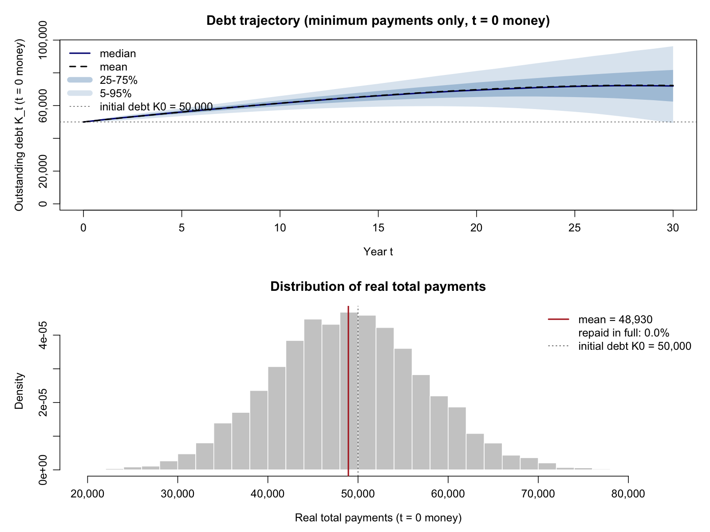
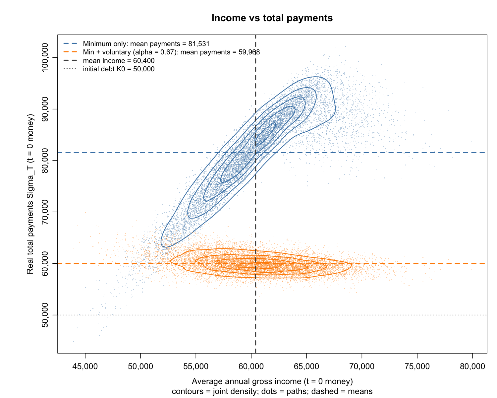
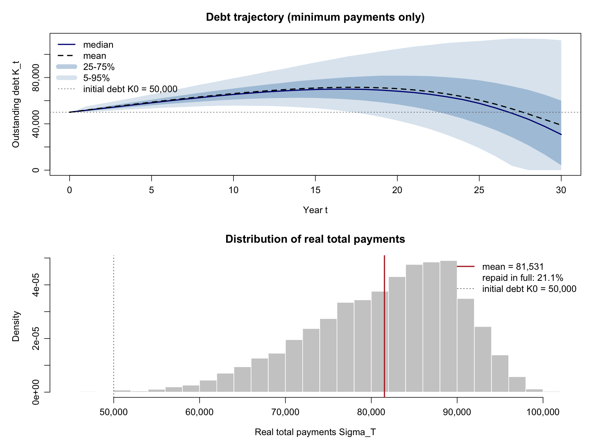
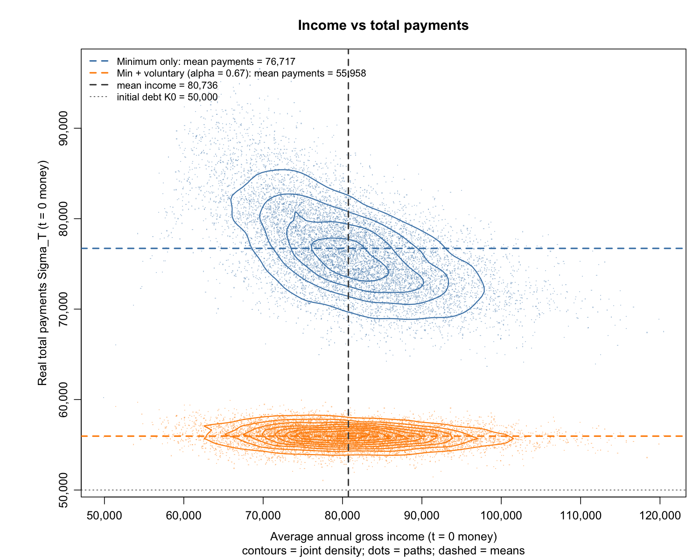
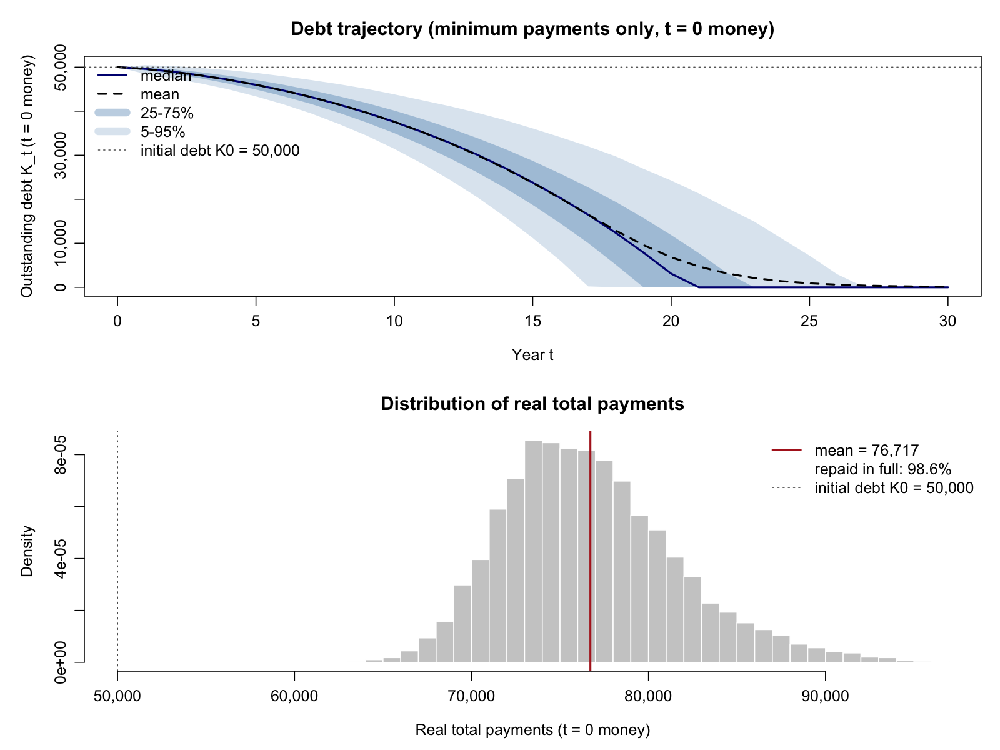

## Intro

$$\text{PLEASE NOTE: This article is still work in progress.} $$

When Erwin Schroedinger studied Physics at the early 20th century in
Vienna, tuition fees, or what at the time was known as “Kollegiengeld”,
for what would be the equivalent of today’s integrated master’s degree
amounted to around 3’000 EUR - 5’000 EUR (inflation adjusted). Despite
the Habsburg empire already nearing the later stages of its later
decline, public finances still stretched far enough to make higher
education accessible. Had he however been born between 1994 and 2003 in
England, he would not been privy to the same privileges and most likely
would have been forced to become a recipient of the UK government’s Plan
2 student loan.

Upon completion of his studies he would have found himself in a similar
situation to many graduates in England and Wales confronted with the
deceptively simple question: *should he pay off the loan as quickly as
possible, or pay the minimum in accordance with his Plan 2 agreement?*

<table>
<thead>
<tr>
<th style="text-align:left;">
Parameter
</th>
<th style="text-align:right;">
Description
</th>
</tr>
</thead>
<tbody>
<tr>
<td style="text-align:left;">
Write-off horizon (T)
</td>
<td style="text-align:right;">
30 years, then remaining debt is cancelled
</td>
</tr>
<tr>
<td style="text-align:left;">
Mandatory repayment rate (ρ)
</td>
<td style="text-align:right;">
9% of income above threshold
</td>
</tr>
<tr>
<td style="text-align:left;">
Repayment threshold (Θ)
</td>
<td style="text-align:right;">
£29,000 at t = 0
</td>
</tr>
<tr>
<td style="text-align:left;">
Threshold freeze
</td>
<td style="text-align:right;">
3 years
</td>
</tr>
<tr>
<td style="text-align:left;">
Threshold indexation
</td>
<td style="text-align:right;">
Indexed to inflation after the freeze
</td>
</tr>
<tr>
<td style="text-align:left;">
Interest rate (iₜ)
</td>
<td style="text-align:right;">
RPI + spread
</td>
</tr>
<tr>
<td style="text-align:left;">
Inflation (RPI)
</td>
<td style="text-align:right;">
Mean 3.0% p.a.
</td>
</tr>
<tr>
<td style="text-align:left;">
Interest spread (sₜ)
</td>
<td style="text-align:right;">
3.0 pp (constant)
</td>
</tr>
<tr>
<td style="text-align:left;">
Payment timing
</td>
<td style="text-align:right;">
Year end; mandatory payment always paid in full
</td>
</tr>
</tbody>
</table>

<strong>Table 1</strong>: Loan structure (Plan 2).

The answer to this question depends on the loan structure (see table 1).
Plan 2 graduates repay a minimum of 9% of earnings above a threshold
(£29’385 for 2026/27, frozen for three years from April 2027), pay
interest that runs from the retail price index (RPI) up to RPI+3
percentage points depending on income (capped at 6% for 2026/27).
Debtors are also free to make optional additional repayments. Whatever
remains of debt is cancelled 30 years after they are first due to repay.

The final point is what makes the question challenging: If you earn
little, you never payoff the debt in its entirety, and the outstanding
debt is written-off by the end of the term. This incentivises minimum
loan payments. If on the other hand you earn more, you might end up
paying off the loan in it’s entirety before the end of the 30 year
deadline. This would make it worthwhile to pay the loan off quickly in
order to avoid high interest costs. But where is the threshold where
this regime switch kicks in, and how might you end up paying if you have
the capital to make advance payments?

This article will aim to answer the motivating question above by looking
at the problem through the lens of three fictional individuals
representing different tax brackets and financial circumstances: Taylor
the teacher, Percy the project manager, and Blake the banker (see
summary in table 2).

Given the above, we see that the problem’s complexity principally
depends on the level and uncertainty of future income. To adequately
formulate an answer to the question we therefore must account for this
uncertainty with some model assumptions. Here we model all accounted
uncertainty incl. salary projections with Monte Carlo simulations. For
more details on the model specifications, skip to the Model section.

<table>
<thead>
<tr>
<th style="text-align:left;">
Parameter
</th>
<th style="text-align:right;">
Taylor
</th>
<th style="text-align:right;">
Percy
</th>
<th style="text-align:right;">
Blake
</th>
</tr>
</thead>
<tbody>
<tr>
<td style="text-align:left;">
Profession
</td>
<td style="text-align:right;">
Teacher
</td>
<td style="text-align:right;">
Project Manager
</td>
<td style="text-align:right;">
Banker
</td>
</tr>
<tr>
<td style="text-align:left;">
Initial debt (K₀)
</td>
<td style="text-align:right;">
£50,000
</td>
<td style="text-align:right;">
£50,000
</td>
<td style="text-align:right;">
£50,000
</td>
</tr>
<tr>
<td style="text-align:left;">
Starting gross salary (I₀)
</td>
<td style="text-align:right;">
£35,000
</td>
<td style="text-align:right;">
£45,000
</td>
<td style="text-align:right;">
£65,000
</td>
</tr>
<tr>
<td style="text-align:left;">
Salary growth
</td>
<td style="text-align:right;">
Mean 4.5% p.a., vol. 0.5%
</td>
<td style="text-align:right;">
Mean 4.5% p.a., vol. 0.5%
</td>
<td style="text-align:right;">
Mean 5.0% p.a., vol. 2.0%
</td>
</tr>
<tr>
<td style="text-align:left;">
Living expenses
</td>
<td style="text-align:right;">
£2,000 / month, indexed to inflation
</td>
<td style="text-align:right;">
£2,300 / month, indexed to inflation
</td>
<td style="text-align:right;">
£2,300 / month, indexed to inflation, with higher lifestyle inflation
</td>
</tr>
<tr>
<td style="text-align:left;">
Lifestyle inflation
</td>
<td style="text-align:right;">
0.5% increase for every % increase in gross salary
</td>
<td style="text-align:right;">
0.5% increase for every % increase in gross salary
</td>
<td style="text-align:right;">
0.8% increase for every % increase in gross salary
</td>
</tr>
<tr>
<td style="text-align:left;">
Initial savings
</td>
<td style="text-align:right;">
£5,000
</td>
<td style="text-align:right;">
£5,000
</td>
<td style="text-align:right;">
£10,000
</td>
</tr>
<tr>
<td style="text-align:left;">
Return on savings
</td>
<td style="text-align:right;">
4.0% nominal p.a.
</td>
<td style="text-align:right;">
4.0% nominal p.a.
</td>
<td style="text-align:right;">
4.0% nominal p.a.
</td>
</tr>
<tr>
<td style="text-align:left;">
Voluntary repayment share (α)
</td>
<td style="text-align:right;">
67% of free income
</td>
<td style="text-align:right;">
67% of free income
</td>
<td style="text-align:right;">
67% of free income
</td>
</tr>
</tbody>
</table>

<strong>Table 2</strong>: Individual characteristics of Taylor the
teacher, Percy the project manager, and Blake the banker.

## Taylor (Teacher, South England)

Consider first the case of Taylor. After graduation from university they
started working as a teacher in the south of England near London,
starting off with earnings of £35’000 per year with £50’000 in student
debt. Their salary trajectory is more or less determined by the UK dept.
of education’s salary bands, peaking at £55’000 in real terms (2026
figure). In their first year of income they pay around £6300 in total
tax and start with monthly living expenses of £2,000 and follow a
conservative spending approach: for every 2% increase in salary, they
increase living expenses by only 1% (see table 2 for a summary). Due to
the height of the income threshold of plan 2 loans, just under £6’000 of
their salary is eligible for minimum loan repayments, amounting to
roughly £540 annually.

<figure class="float-right" style="width:45%">

<figcaption>
<strong>Figure 2</strong>: Average annual gross income vs. total loan
payments for the minimal repayment (blue) and the min + voluntary
repayment plan (orange) in real terms. Under the given scenario,
voluntary payments do not lead to loan discounts.
</figcaption>
</figure>

Would Taylor be better off paying the minimum repayment plan or could
they benefit from additional voluntary payemnts? An answer can be found
in figure 2. Figure 2 shows the relationship between the average annual
real gross income vs. the real total costs for the plan 2 loan. Here
each dot represents one of 10’000 simulated scenarios, with blue dots
representing the minimum repayment plan and orange dots representing
minimum + voluntary repayemt plan, whereby voluntary payments consist of
67% of annual free-cash (i.e. left-over cash savings after taxes, living
expenses and minimum loan repayments). The dashed lines represent the
mean of the respective observable.

First off we see that the mean real total payments in the minimum and
minimum + voluntary repayment plan lies at £48’930 and £67’682,
respectively. That is, a teacher is not expected to save any money by
making additional payments. Moreover, with the minimum payment plan they
even stand to get a discount of £1’070 on the total debt of £50’000.
Here the UK government is effectively subsidising their cost of tuition.
We can generalise that every pound paid in excess of the minimum
repayment plan is lost to the government. It simply hands over money
that would have been written off after 30 years. This can also be seen
in the positive correlation in the blue scenarios in figure 2 in
scenarios where more taxable income was generated (e.g. through Taylor’s
secondary income streams): the more they earn, the higher the loan cost.

<figure class="float-left" style="width:45%">

<figcaption>
<strong>Figure 3</strong>: Real debt trajectory of minimum repayment
plan, together with a histogram of real total payments. Taylor’s
outstanding debt continually increases despite an average payment of
around £136 per month over 30 years.
</figcaption>
</figure>

Taking a closer look into the data, we see that without Taylor’s
voluntary payments, the repayment rate is not sufficient to meaningfully
reduce the level of debt i.e. that these payments are always outsized by
loan increases of interest. Each simulated trajectory the loan is not
fully repaid, with a mean of around £74’000 being written off at the end
of the 30 year term, as shown in the debt trajectory of figure 3.

<!-- This article aims to answer these with a collection of illustrative plots. It aims to answer this question doing a stochastic-simulation of the factors influencing the loans structure (income trajectories over 30y, RPI, living expenses, inflation, UK-tax bands, savings incl. capital gains). -->

## Percy (Project Manager (PM), London)

<figure class="float-right" style="width:45%">

<figcaption>
<strong>Figure 9</strong>: Average annual gross income vs. total loan
payments for the minimal repayment (blue) and the min + voluntary
repayment plan (orange) in real terms. Under the given scenario,
voluntary payments do not lead to loan discounts.
</figcaption>
</figure>
<figure class="float-left" style="width:45%">

<figcaption>
<strong>Figure X</strong>: Real debt trajectory of minimum repayment
plan, together with a histogram of real total payments. Taylor’s
outstanding debt continually increases despite an average payment of
around £136 per month over 30 years.
</figcaption>
</figure>

## Blake (Banker, London)

<figure class="float-right" style="width:45%">

<figcaption>
<strong>Figure X</strong>: Average annual gross income vs. total loan
payments for the minimal repayment (blue) and the min + voluntary
repayment plan (orange) in real terms. Under the given scenario,
voluntary payments do not lead to loan discounts.
</figcaption>
</figure>
<figure class="float-left" style="width:45%">

<figcaption>
<strong>Figure X</strong>: Real debt trajectory of minimum repayment
plan, together with a histogram of real total payments. Taylor’s
outstanding debt continually increases despite an average payment of
around £136 per month over 30 years.
</figcaption>
</figure>

**Figure 4**: Year of total repayment vs. total loan payments for the
minimal + voluntary repayment plan, coloured by mean real salary in real
terms. Voluntary payments significantly lower the loan time until
repayment, reducing accumulated interest and loan cost. Alpha = 0.67

## Model assumptions

The model follows one graduate through $$T = 30$$ annual steps and
simulates 10’000 possible futures. All strategies run on the same random
draws, so differences between them come from the strategy alone.

### Loan

The balance grows with interest and shrinks with repayments, paid at
year end:

$$
K_t = (1 + i_t)\,K_{t-1} - r_t, \qquad i_t = \mathrm{RPI}_t + s_t
$$

The mandatory repayment is a share $$\rho$$ of last year’s income above
the threshold $$\Theta_t$$, and is paid in full as long as a balance
remains:

$$
r^{\min}_t = \rho \,\max\!\big(I_{t-1} - \Theta_t,\; 0\big)\cdot \mathbf{1}\{K_{t-1} > 0\}
$$

The threshold is frozen for three years and then follows CPI inflation
$$\pi_t$$:

$$
\Theta_t = \Theta_{t-1}\,\big(1 + \kappa\,\pi_t\,\mathbf{1}\{t > 3\}\big)
$$

(with $$\kappa = 1$$: full indexation). Whatever is left at $$T$$ is
written off. Voluntary repayments $$r^{\mathrm{vol}}_t \ge 0$$ come on
top, so the total payment is $$r_t = r^{\min}_t + r^{\mathrm{vol}}_t$$.

### Income and living costs

Gross income grows with a rate $$g_t$$ that mean-reverts around its
long-run level $$\mu$$ (speed $$\lambda$$, volatility $$\sigma$$):

$$
I_t = I_{t-1}\,e^{g_t}, \qquad g_t = g_{t-1} + \lambda\,(\mu - g_{t-1}) + \sigma\,\varepsilon_t, \quad \varepsilon_t \sim \mathcal{N}(0,1)
$$

Living costs $$L_t$$ grow with inflation plus a share $$\eta$$ of the
growth that exceeds it:

$$
L_t = L_{t-1}\,\exp\!\Big(\ln(1+\pi_t) + \eta\,\big(g_t - \ln(1+\pi_t)\big)\Big)
$$

With $$\eta = 0$$ there is no lifestyle inflation, and with $$\eta = 1$$
spending grows as fast as income.

### Savings and voluntary repayment

Free cash flow is income minus tax and National Insurance $$\tau(I_t)$$
and living costs. A saver with voluntary share $$\alpha$$ pays that
share of the cash left after the mandatory payment into the loan, and
the rest accrues in a savings pot earning $$s_{\mathrm{sav}}$$:

$$
C_t = I_t - \tau(I_t) - L_t, \qquad
r^{\mathrm{vol}}_t = \alpha\,\max\!\big(C_t^{+} - r^{\min}_t,\; 0\big)
$$

$$
S_t = (1 + s_{\mathrm{sav}})\,S_{t-1} + C_t - r_t
$$

The pot also absorbs years in which cash flow falls short of the
mandatory payment.

### Costs are measured in real terms

Inflation is resampled in pairs of (CPI, RPI) from observed annual UK
rates since 1990, so the two series stay correlated. Total cost is the
sum of repayments in t = 0 money:

$$
\Sigma_T = \sum_{t=1}^{T} r_t \prod_{u=1}^{t} \frac{1}{1 + \pi_u}
$$

The question is then how $$\mathbb{E}[\Sigma_T]$$ depends on $$\alpha$$
and on the income path.

### What the model leaves out

Interest is RPI plus a constant $$s_t = 3$$ percentage points, the upper
end of the income-dependent scale. The model also covers a single person
with no career breaks, other debts or policy changes, and savings
returns are fixed and untaxed.

## Not financial advice

Actuarly is an independent think tank. We are not financial advisers,
and nothing published on this site constitutes financial, investment,
tax or legal advice, or a recommendation to take or avoid any particular
action.

Our articles and models are illustrative. They rest on stated
assumptions and simplifications, and their results describe average or
simulated outcomes, not what will happen to you. Questions about
personal finance, such as how to manage a student loan, whether to make
voluntary repayments, or how to invest, depend on your individual
circumstances: income, other debts, savings, tax position, risk
tolerance and goals. Policy rules also change.

Before making a financial decision, consider your own situation
carefully and, where appropriate, seek advice from a qualified,
regulated professional. For loan terms, check the official guidance from
the loan provider or the government.

<figure>

<figcaption aria-hidden="true"><strong>Figure 4</strong>: Year of total
repayment vs. total loan payments for the minimal + voluntary repayment
plan, coloured by mean real salary in real terms. Voluntary payments
significantly lower the loan time until repayment, reducing accumulated
interest and loan cost. Alpha = 0.67</figcaption>
</figure>

Cash-flow summary: (a) minimal loan repayment; (b) minimal + voluntary
loan repayment. Alpha = 0.67

Loan cost development and total distribution: (a) minimal loan
repayment; (b) minimal + voluntary loan repayment. Alpha = 0.67

Total real loan cost over different values of alpha. Alpha is the
proportion of savings used for voluntary payments in addition to the
minimum.

Expected yearly income allocation: (a) minimal loan repayment; (b)
minimal + voluntary loan repayment. Alpha = 0.67

Expected real savings: (a) minimal loan repayment; (b) minimal +
voluntary loan repayment. Alpha = 0.67

### Sensitivity analysis

Sensitivity of the results to the model parameters, by alpha.

**Table 1**: Local sensitivity analysis (α = 0.67)

| Indicator             |   Baseline | Sensitivity | per +1pp rho | per +1 yr T | per +5,000 I0 | per +10,000 down | per +0.5pp sav_rate | elast theta0 | elast rho0 | elast T | elast I0 | elast sav |
|:----------------------|-----------:|------------:|-------------:|------------:|--------------:|-----------------:|--------------------:|-------------:|-----------:|--------:|---------:|----------:|
| mean_real_payments    |  48993.629 |   -2498.195 |     5443.737 |    2850.509 |     17341.820 |         5000.000 |               0.000 |       -1.479 |      1.000 |   1.745 |    2.478 |     0.000 |
| p05_real_payments     |  35185.265 |   -2459.705 |     3909.474 |    2032.265 |     15218.688 |         5000.000 |               0.000 |       -2.027 |      1.000 |   1.733 |    3.028 |     0.000 |
| p50_real_payments     |  48889.016 |   -2489.448 |     5432.113 |    2824.110 |     17331.305 |         5000.000 |               0.000 |       -1.477 |      1.000 |   1.733 |    2.482 |     0.000 |
| p95_real_payments     |  63049.690 |   -2536.311 |     7005.521 |    3872.576 |     19496.222 |         5000.000 |               0.000 |       -1.167 |      1.000 |   1.843 |    2.165 |     0.000 |
| mean_payment_share    |      0.034 |      -0.002 |        0.004 |       0.001 |         0.008 |            0.004 |               0.000 |       -1.496 |      1.000 |   0.442 |    1.527 |     0.000 |
| prob_repaid           |      0.000 |       0.000 |        0.000 |       0.000 |         0.002 |            0.000 |               0.000 |           NA |         NA |      NA |      Inf |        NA |
| mean_payoff_year      |         NA |          NA |           NA |          NA |            NA |               NA |                  NA |           NA |         NA |      NA |       NA |        NA |
| mean_real_writeoff    |  72236.383 |    4450.384 |    -8504.718 |    -173.486 |    -29364.918 |       -14877.884 |               0.000 |        1.787 |     -1.060 |  -0.072 |   -2.846 |     0.000 |
| mean_real_end_savings | 107474.247 |    3009.308 |    -6275.457 |    6972.763 |    -29992.449 |        -7256.265 |            6247.825 |        0.812 |     -0.526 |   1.946 |   -1.953 |     0.465 |
| prob_shortfall        |      0.179 |      -0.035 |        0.031 |       0.000 |         0.337 |            0.000 |               0.000 |       -5.626 |      1.550 |   0.000 |   13.222 |     0.000 |

<!-- Render with: -->
