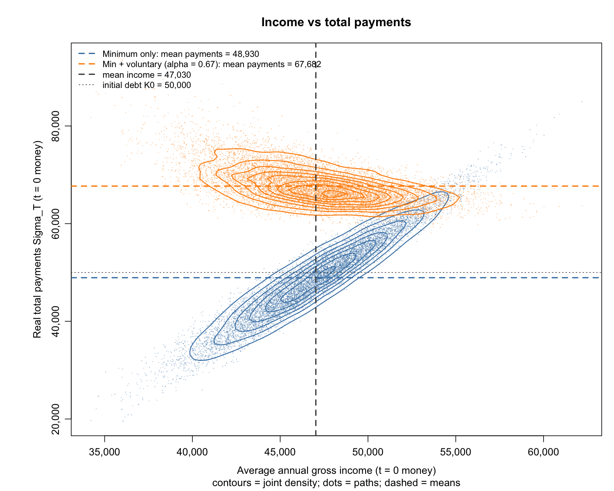
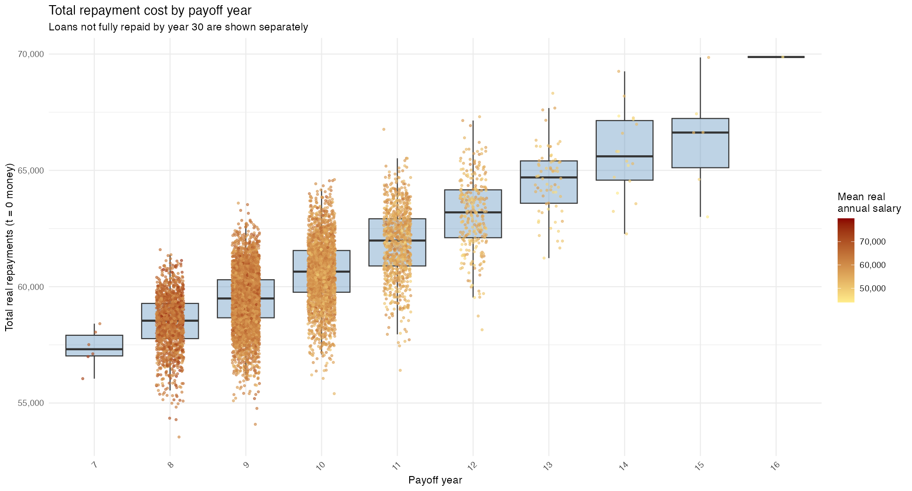
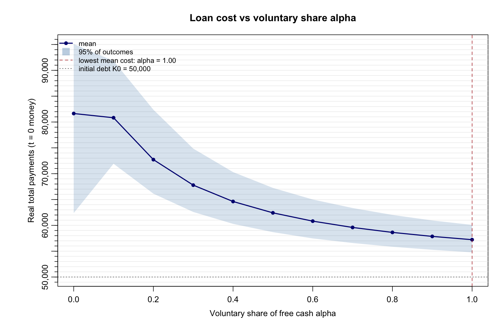
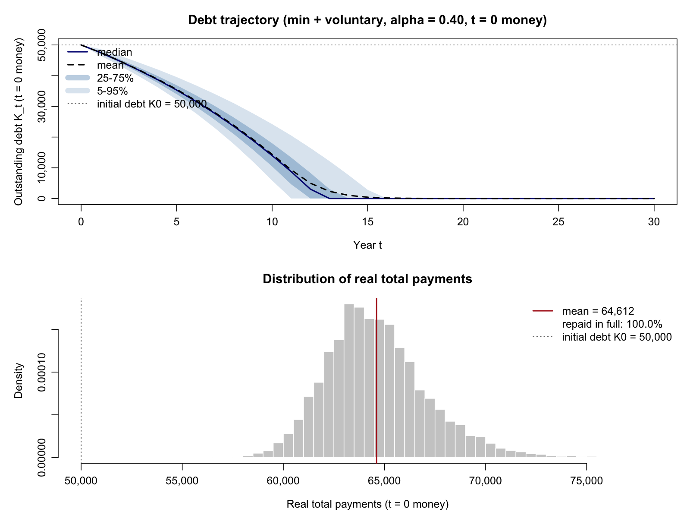

Recent graduates face a mountain of student debt and an uncertain
financial future. A Plan 2 loan may be repaid in full or partly written
off after 30 years, so do graduates gain by paying it off early?

By Christopher Buck

Author’s note: this article is a work in progress, and figures and
wording may still change. The results are illustrative and not financial
advice.

When Erwin Schroedinger studied Physics in the early 20th century in
Vienna, tuition fees, or what at the time was known as “Kollegiengeld”,
for the equivalent of today’s integrated master’s degree amounted to
around 3’000 EUR - 5’000 EUR (inflation adjusted). Despite the Habsburg
empire already nearing the later stages of its decline, public finances
still stretched far enough to make higher education accessible. Had
Schroedinger been born between 1994 and 2003 in England, he would not
have been privy to the same privilege: He would have been forced to
become a recipient of the UK government’s Plan 2 student loan.

Consequently, upon completion of his studies he would have found himself
in a similar situation to many graduates in England and Wales today.
They are confronted with the deceptively simple question: *should they
pay off the loan as quickly as possible, or pay the minimum in
accordance with his Plan 2 agreement?*

<table>
<thead>
<tr>
<th style="text-align:left;">
Parameter
</th>
<th style="text-align:right;">
Description
</th>
</tr>
</thead>
<tbody>
<tr>
<td style="text-align:left;">
Write-off horizon (T)
</td>
<td style="text-align:right;">
30 years, then remaining debt is cancelled
</td>
</tr>
<tr>
<td style="text-align:left;">
Mandatory repayment rate (ρ)
</td>
<td style="text-align:right;">
9% of income above threshold
</td>
</tr>
<tr>
<td style="text-align:left;">
Repayment threshold (Θ)
</td>
<td style="text-align:right;">
£29,000 at t = 0
</td>
</tr>
<tr>
<td style="text-align:left;">
Threshold freeze
</td>
<td style="text-align:right;">
3 years
</td>
</tr>
<tr>
<td style="text-align:left;">
Threshold indexation
</td>
<td style="text-align:right;">
Indexed to inflation after the freeze
</td>
</tr>
<tr>
<td style="text-align:left;">
Interest rate (iₜ)
</td>
<td style="text-align:right;">
RPI + spread
</td>
</tr>
<tr>
<td style="text-align:left;">
Inflation (RPI)
</td>
<td style="text-align:right;">
Mean 3.0% p.a.
</td>
</tr>
<tr>
<td style="text-align:left;">
Interest spread (sₜ)
</td>
<td style="text-align:right;">
3.0 pp (constant)
</td>
</tr>
<tr>
<td style="text-align:left;">
Payment timing
</td>
<td style="text-align:right;">
Year end; mandatory payment always paid in full
</td>
</tr>
</tbody>
</table>

<strong>Table 1</strong>: Loan structure (Plan 2).

The answer to this question depends on the loan structure (see table 1).
Plan 2 graduates repay a minimum of 9% of earnings above a threshold
(£29’385 for 2026/27, frozen for three years from April 2027), pay
interest that runs from the retail price index (RPI) up to RPI+3
percentage points depending on income (capped at 6% for 2026/27).
Debtors are also free to make optional additional repayments. Whatever
remains of debt is cancelled 30 years after they are first due to repay.

The final point is what makes the question challenging: If you earn
little, you never payoff the debt in its entirety, and the outstanding
debt is written-off by the end of the term. This incentivises minimum
loan payments. If on the other hand you earn more, you might end up
paying off the loan in it’s entirety before the end of the 30 year
deadline. This would make it worthwhile to pay the loan off quickly in
order to avoid high interest costs. But where is the threshold where
this regime switch kicks in, and how might you end up paying if you have
the capital to make advance payments?

This article will aim to answer the motivating question above by looking
at the problem through the lens of three fictional individuals
representing different tax brackets and financial circumstances: Taylor
the teacher, Percy the project manager (PM), and Blake the banker (see
summary in table 2).

Given the above, we see that the problem’s complexity principally
depends on the level and uncertainty of future income. To adequately
formulate an answer to the question we therefore must account for this
uncertainty with some model assumptions. Here we model all accounted
uncertainty incl. salary projections with Monte Carlo simulations. For
more details on the model specifications, skip to the Model section.

<table>
<thead>
<tr>
<th style="text-align:left;">
Parameter
</th>
<th style="text-align:right;">
Taylor
</th>
<th style="text-align:right;">
Percy
</th>
<th style="text-align:right;">
Blake
</th>
</tr>
</thead>
<tbody>
<tr>
<td style="text-align:left;">
Profession
</td>
<td style="text-align:right;">
Teacher
</td>
<td style="text-align:right;">
Project Manager
</td>
<td style="text-align:right;">
Banker
</td>
</tr>
<tr>
<td style="text-align:left;">
Initial debt (K₀)
</td>
<td style="text-align:right;">
£50’000
</td>
<td style="text-align:right;">
£50’000
</td>
<td style="text-align:right;">
£50’000
</td>
</tr>
<tr>
<td style="text-align:left;">
Starting gross salary (I₀)
</td>
<td style="text-align:right;">
£35’000
</td>
<td style="text-align:right;">
£45’000
</td>
<td style="text-align:right;">
£65’000
</td>
</tr>
<tr>
<td style="text-align:left;">
Salary growth
</td>
<td style="text-align:right;">
Mean 4.5% p.a., vol. 0.5%
</td>
<td style="text-align:right;">
Mean 4.5% p.a., vol. 0.5%
</td>
<td style="text-align:right;">
Mean 5.0% p.a., vol. 2.0%
</td>
</tr>
<tr>
<td style="text-align:left;">
Living expenses
</td>
<td style="text-align:right;">
£2’000 / month, indexed to inflation
</td>
<td style="text-align:right;">
£2’300 / month, indexed to inflation
</td>
<td style="text-align:right;">
£2’300 / month, indexed to inflation, with higher lifestyle inflation
</td>
</tr>
<tr>
<td style="text-align:left;">
Lifestyle inflation
</td>
<td style="text-align:right;">
0.5% increase for every % increase in gross salary
</td>
<td style="text-align:right;">
0.5% increase for every % increase in gross salary
</td>
<td style="text-align:right;">
0.8% increase for every % increase in gross salary
</td>
</tr>
<tr>
<td style="text-align:left;">
Initial savings
</td>
<td style="text-align:right;">
£1’000
</td>
<td style="text-align:right;">
£1’000
</td>
<td style="text-align:right;">
£10’000
</td>
</tr>
<tr>
<td style="text-align:left;">
Return on savings
</td>
<td style="text-align:right;">
4.0% nominal p.a.
</td>
<td style="text-align:right;">
4.0% nominal p.a.
</td>
<td style="text-align:right;">
4.0% nominal p.a.
</td>
</tr>
<tr>
<td style="text-align:left;">
Suggested Voluntary repayment share (α)
</td>
<td style="text-align:right;">
0% of free income
</td>
<td style="text-align:right;">
e.g. 40% of free income
</td>
<td style="text-align:right;">
X% of free income
</td>
</tr>
</tbody>
</table>

<strong>Table 2</strong>: Individual characteristics of Taylor the
teacher, Percy the project manager, and Blake the banker.

## Taylor (Teacher, South England)

Consider first the case of Taylor. After graduation from university they
started working as a teacher in the south of England near London,
starting off with earnings of £35’000 per year with £50’000 in student
debt. Their salary trajectory is more or less determined by the UK dept.
of education’s salary bands, peaking at £55’000 in real terms (2026
figure). In their first year of income they pay around £6300 in total
tax and start with monthly living expenses of £2,000 and follow a
conservative spending approach: for every 2% increase in salary, they
increase living expenses by only 1% (see table 2 for a summary). Due to
the height of the income threshold of plan 2 loans, just under £6’000 of
their salary is eligible for minimum loan repayments, amounting to
roughly £540 annually.

<figure class="float-right" style="width:45%">

<figcaption>
<strong>Figure 2.1</strong>: Average annual gross income vs. total loan
payments for the minimal repayment (blue) and the min + voluntary
repayment plan (orange) in real terms. Under the given scenario,
voluntary payments do not lead to loan discounts.
</figcaption>
</figure>

Would Taylor be better off paying the minimum repayment plan or could
they benefit from additional voluntary payments? An answer can be found
in figure 2.1. Figure 2.1 shows the relationship between the average
annual real gross income vs. the real total costs for the plan 2 loan.
Here each dot represents one of 10’000 simulated scenarios, with blue
dots representing the minimum repayment plan and orange dots
representing minimum + voluntary repayment plan, whereby voluntary
payments consist of 67% of annual free-cash (i.e. left-over cash savings
after taxes, living expenses and minimum loan repayments). The dashed
lines represent the mean of the respective observable.

First off we see that the mean real total payments in the minimum and
minimum + voluntary repayment plan lies at £48’930 and £67’682,
respectively. That is, a teacher is not expected to save any money by
making additional payments. Moreover, with the minimum payment plan they
even stand to get a discount of £1’070 on the total debt of £50’000.
Here the UK government is effectively subsidising their cost of tuition.
We can generalise that every pound paid in excess of the minimum
repayment plan is lost to the government. It simply hands over money
that would have been written off after 30 years. This can also be seen
in the positive correlation in the blue scenarios in figure 2.1 in
scenarios where more taxable income was generated (e.g. through Taylor’s
secondary income streams): higher earnings go with higher loan costs.

<figure class="float-left" style="width:45%">

<figcaption>
<strong>Figure 2.2</strong>: Real debt trajectory of minimum repayment
plan, together with a histogram of real total payments. Taylor’s
outstanding debt continually increases despite an average payment of
around £136 per month over 30 years.
</figcaption>
</figure>

Taking a closer look into the data, we see that without Taylor’s
voluntary payments, the repayment rate is not sufficient to meaningfully
reduce the level of debt i.e. that these payments are always outsized by
loan increases of interest. Each simulated trajectory the loan is not
fully repaid, with a mean of around £74’000 being written off at the end
of the 30 year term, as shown in the debt trajectory of figure 2.2.

To summarise, Taylor is best-off following the minimum loan repayment
plan set out by her plan 2 loan agreement. Given their expected salary
trajectory they are unlikely to pay off their debt. Given that their
salary excess over the repayment threshold is small, they stand to lose
when making voluntary repayments.

<!-- This article aims to answer these with a collection of illustrative plots. It aims to answer this question doing a stochastic-simulation of the factors influencing the loans structure (income trajectories over 30y, RPI, living expenses, inflation, UK-tax bands, savings incl. capital gains). -->

## Percy (Project Manager, London)

Next we consider the case of Taylor. They enter the workforce as a PM in
the London earning £45’000 in their first year with £50’000 in student
debt. Being employed by the private sector, their salary varies more
widely, with the potential of increasing significantly. In their first
year of income they pay around £9’100 in total tax and given the higher
expenses in London, start with monthly living expenses of £2’300. They
follow a conservative spending approach: for every 2% increase in
salary, they increase living expenses by only 1% (see table 2 for a
summary). Around £16’000 of their salary is eligible for minimum loan
repayments, amounting to roughly £1’440 annually.

<figure class="float-right" style="width:45%">

<figcaption>
<strong>Figure 3.1</strong>: Average annual gross income vs. total loan
payments for the minimal repayment (blue) and the min + voluntary
repayment plan (orange) in real terms. Over the 30y period, Percy stands
to save just over £22’000 in real terms when making minimum + voluntary
repayments.
</figcaption>
</figure>

In figure 3.1 we again see the relationship between the average annual
real gross income vs. the real total costs for the plan 2 loan from the
stochastic simulation, with blue dots representing the minimum repayment
plan and orange dots representing minimum + voluntary repayment plan.
While the figure suggests real expected savings of over £22’000 over the
30y loan term when following the minimum + voluntary repayment plan
(orange dots), whereby voluntary payments consist of 67% of annual
free-cash (i.e. left-over cash savings after taxes, living expenses and
minimum loan repayments), it makes sense to further consider the
disadvantages they may have to incur to be able to unlock this financial
return.

For the given voluntary repayment structure of using 67% of free cash,
Percy can expect to repay the loan in full after just over 9 years (see
figure 3.2). That is, over these 9 or so years, they pay between £1’440
and £1’800 annually for the minimum repayments and £4’800 and £4’900 for
voluntary repayments annually. They are left with around £2’400 a year
for savings, saving up only around £24’000 over 10 years.

<figure class="float-left" style="width:70%">

<figcaption>
<strong>Figure 3.2</strong>: Results from stochastic simulation with
10’000 simulations, showing year of total repayment vs. Total loan
payments for the minimal + voluntary repayment scheme, coloured by mean
real salary in real terms. Voluntary payments significantly lower the
loan time until repayment, reducing accumulated intrest and loan costs.
Share of free cash used for voluntary repayments (Alpha) = 0.67
</figcaption>
</figure>

If they were interested in building up savings (e.g. by trying to get on
the housing ladder) they might be better off forfeiting the loan
interest savings unlocked by voluntary payments to instead focus on
their savings. That way they could expect to amass around £80’000 in
capital.

A further option could be to reduce the share of free capital used for
voluntary payments from 67% to a lower ratio. This would inevitably lead
to higher costs on payments for the student loan, at the benefit of
having more liquidity, i.e. savings for e.g. a house deposit. The
relationship between varying the share of free cash on student loan
costs can be seen in figure 3.3. Figure 3.3 shows real total loan costs
for a given free-cash proportion used for voluntary payments (alpha).

<figure class="float-left" style="width:70%">

<figcaption>
<strong>Figure 3.3</strong>: Results from stochastic simulation with
10’000 simulations, showing real total loan costs over different alphae.
Alpha is the proportion of savings used for voluntary payments in
addition to the minimum. While increasing voluntary payments made, the
effect on voluntarily paying more shrinks for high alpha.
</figcaption>
</figure>

While we see that increasing the proportion of voluntary payments
reduces loan costs, the reduction is greater for small alpha than for
large alpha. For example, if Percy decided to set his proportion of
voluntary payments at 30% he reduces expected repayments by £5’000 by
increasing this by 10 percentage points to 40%. In contrast, at alpha of
67% Percy can only reduce his cost by £1’000 for a proportion of
voluntary cash payments increase by +10 percentage points to 77%. Percy
can therefore decide to lower his proportion of alpha to e.g. 40%,
thereby increasing loan costs and time to repayment by around £6’000
over the course of its lifetime and from 9 to 15 years, respectively, at
the benefit of increasing his capacity to save money.

<figure class="float-left" style="width:45%">

<figcaption>
<strong>Figure 3.4</strong>: Real debt trajectory of minimum + voluntary
repayment plan (alpha =40%), together with a histogram of real total
payments. Percy’s pays off his debt after around 15 years, leaving him
with expected total loan costs of just under £65’000.
</figcaption>
</figure>

We can conclude that Percy clearly benefits from making voluntary
benefits. When making voluntary repayments of 67% of free cash Percy
stands to reduce his total real cost of tuition by around £22’000 over
the course of the loan’s lifetime, taking him on average just over 9
years to repay the loan in full, making total annual payments of £6’200
to £6’700 (around £550 monthly, in real terms). This however comes at a
cost: Using 67% of his annual free-cash (after taxes, living expenses,
minimum student payments), Percy has less money left over for savings,
decreasing his ability to save of for significant life expenses (e.g. a
house deposit). As a compromise Percy could consider reducing his
voluntary repayments to e.g. 40% of free-cash. This would still allow
him to reduce his total loan costs by around £16’000, whilst nearly
doubling Percy’s average end-of-year savings from £2’400 to around
£4’400.

Whether this is worthwhile depends on Percy’s own plans: how much
liquidity they need, what they could earn on the money they keep, and
how willing they are to defer consumption. Every option involves a
trade-off with other goals, so there is no single best share.

## Blake (Banker, London)

<figure class="float-right" style="width:45%">

<figcaption>
<strong>Figure X</strong>: Average annual gross income vs. total loan
payments for the minimal repayment (blue) and the min + voluntary
repayment plan (orange) in real terms. Under the given scenario,
voluntary payments do not lead to loan discounts.
</figcaption>
</figure>
<figure class="float-left" style="width:45%">

<figcaption>
<strong>Figure 3.4</strong>: Real debt trajectory of minimum repayment
plan, together with a histogram of real total payments. Percy’s
outstanding debt continually increases despite an average payment of
around £136 per month over 30 years.
</figcaption>
</figure>
<!--

**Figure 4**: Year of total repayment vs. total loan payments for the minimal + voluntary repayment plan, coloured by mean real salary in real terms. Voluntary payments significantly lower the loan time until repayment, reducing accumulated interest and loan costs. Alpha = 0.67

-->

## Model assumptions

The model follows one graduate through $$T = 30$$ annual steps and
simulates 10’000 possible futures. All strategies run on the same random
draws, so differences between them come from the strategy alone.

### Loan

The balance grows with interest and shrinks with repayments, paid at
year end:

$$
K_t = (1 + i_t)\,K_{t-1} - r_t, \qquad i_t = \mathrm{RPI}_t + s_t
$$

The mandatory repayment is a share $$\rho$$ of last year’s income above
the threshold $$\Theta_t$$, and is paid in full as long as a balance
remains:

$$
r^{\min}_t = \rho \,\max\!\big(I_{t-1} - \Theta_t,\; 0\big)\cdot \mathbf{1}\{K_{t-1} > 0\}
$$

The threshold is frozen for three years and then follows CPI inflation
$$\pi_t$$:

$$
\Theta_t = \Theta_{t-1}\,\big(1 + \kappa\,\pi_t\,\mathbf{1}\{t > 3\}\big)
$$

(with $$\kappa = 1$$: full indexation). Whatever is left at $$T$$ is
written off. Voluntary repayments $$r^{\mathrm{vol}}_t \ge 0$$ come on
top, so the total payment is $$r_t = r^{\min}_t + r^{\mathrm{vol}}_t$$.

### Income and living costs

Gross income grows with a rate $$g_t$$ that mean-reverts around its
long-run level $$\mu$$ (speed $$\lambda$$, volatility $$\sigma$$):

$$
I_t = I_{t-1}\,e^{g_t}, \qquad g_t = g_{t-1} + \lambda\,(\mu - g_{t-1}) + \sigma\,\varepsilon_t, \quad \varepsilon_t \sim \mathcal{N}(0,1)
$$

Living costs $$L_t$$ grow with inflation plus a share $$\eta$$ of the
growth that exceeds it:

$$
L_t = L_{t-1}\,\exp\!\Big(\ln(1+\pi_t) + \eta\,\big(g_t - \ln(1+\pi_t)\big)\Big)
$$

With $$\eta = 0$$ there is no lifestyle inflation, and with $$\eta = 1$$
spending grows as fast as income.

### Savings and voluntary repayment

Free cash flow is income minus tax and National Insurance $$\tau(I_t)$$
and living costs. A saver with voluntary share $$\alpha$$ pays that
share of the cash left after the mandatory payment into the loan, and
the rest accrues in a savings pot earning $$s_{\mathrm{sav}}$$:

$$
C_t = I_t - \tau(I_t) - L_t, \qquad
r^{\mathrm{vol}}_t = \alpha\,\max\!\big(C_t^{+} - r^{\min}_t,\; 0\big)
$$

$$
S_t = (1 + s_{\mathrm{sav}})\,S_{t-1} + C_t - r_t
$$

The pot also absorbs years in which cash flow falls short of the
mandatory payment.

### Costs are measured in real terms

Inflation is resampled in pairs of (CPI, RPI) from observed annual UK
rates since 1990, so the two series stay correlated. Total cost is the
sum of repayments in t = 0 money:

$$
\Sigma_T = \sum_{t=1}^{T} r_t \prod_{u=1}^{t} \frac{1}{1 + \pi_u}
$$

The question is then how $$\mathbb{E}[\Sigma_T]$$ depends on $$\alpha$$
and on the income path.

### What the model leaves out

Interest is RPI plus a constant $$s_t = 3$$ percentage points, the upper
end of the income-dependent scale. The model also covers a single person
with no career breaks, other debts or policy changes, and savings
returns are fixed and untaxed.

## Not financial advice

Actuarly is an independent think tank. We are not financial advisers,
and nothing published on this site constitutes financial, investment,
tax or legal advice, or a recommendation to take or avoid any particular
action.

Our articles and models are illustrative. They rest on stated
assumptions and simplifications, and their results describe average or
simulated outcomes, not what will happen to you. Questions about
personal finance, such as how to manage a student loan, whether to make
voluntary repayments, or how to invest, depend on your individual
circumstances: income, other debts, savings, tax position, risk
tolerance and goals. Policy rules also change.

Before making a financial decision, consider your own situation
carefully and, where appropriate, seek advice from a qualified,
regulated professional. For loan terms, check the official guidance from
the loan provider or the government.

<!-- Render with: -->
